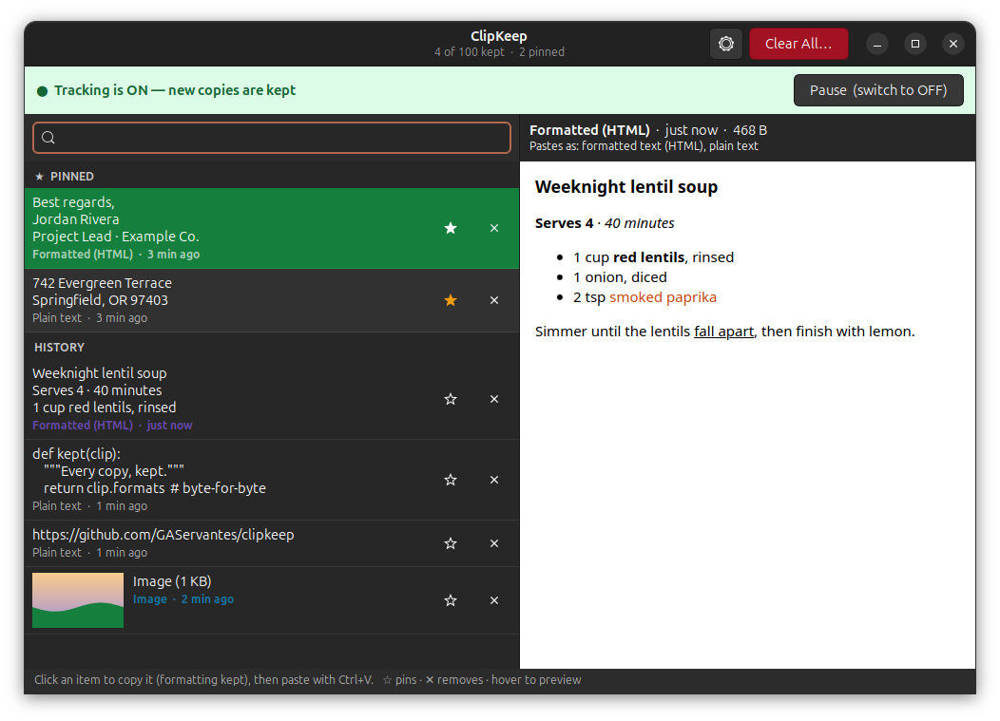
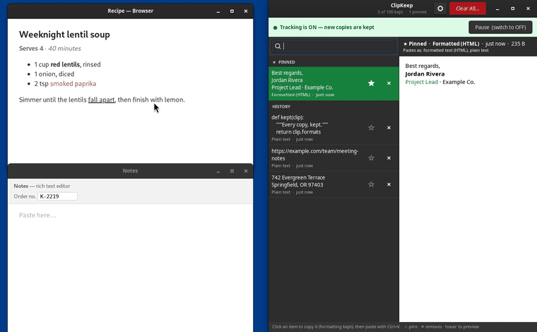
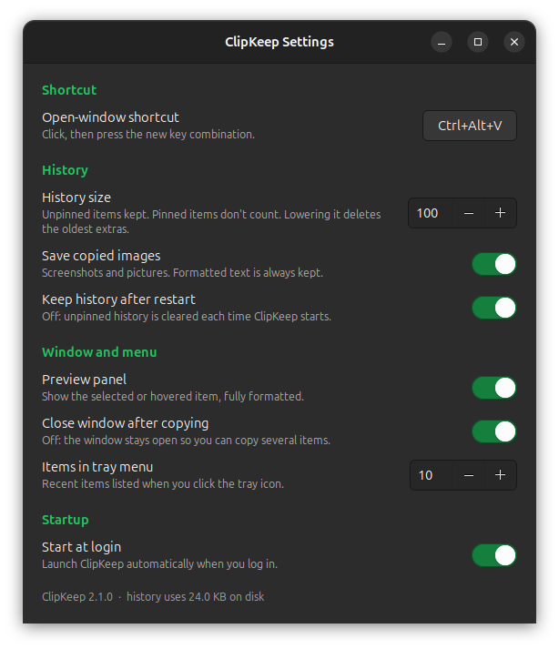

<p align="center"></p>

<h1 align="center">ClipKeep</h1>
<p align="center"><b>Every copy, kept. Formatting and all.</b><br>
A clipboard history for the GNOME desktop on Ubuntu.</p>



ClipKeep sits in your top bar and keeps the last 100 things you copied. Pick
one and it goes back on your clipboard **exactly as it was copied**: bold
stays bold, links stay links, colors and lists survive, images stay images.

ClipKeep saves every format the app offered (HTML, RTF, plain text, images,
file lists, app-specific data) byte-for-byte, and offers all of them back
when you paste. The preview shows each item the way it will paste.

<p align="center"></p>

<p align="center"><sub>Copy formatted text, copy something else, then find the first copy by
typing and paste it, formatting and all. Recorded in GNOME 50 on Ubuntu 26.04.</sub></p>

## What it does

- **Tray icon.** A green clipboard means tracking is on; grey with a red pause
  badge means paused. Click it for your pinned and recent items (click one to
  copy it), a clear "Pause tracking → switch to OFF" toggle, Clear all,
  Settings and Quit.
- **History window** (<kbd>Ctrl</kbd>+<kbd>Alt</kbd>+<kbd>V</kbd>). Click an
  item to copy it, then paste with <kbd>Ctrl</kbd>+<kbd>V</kbd>. Just start
  typing to search. ☆ pins an item and ✕ removes it.
- **Pins.** Pinned items stay at the top, never count toward the limit, and
  survive Clear All (unless you tick "Also delete pinned").
- **Preview.** See the selected or hovered item the way it will paste, with
  real formatting and full-size images. The preview never loads anything from
  the internet and never runs scripts.
- **Private by default.** Copies from password managers that mark them as
  secret aren't saved. History is stored only on your computer, readable only
  by you.
- **Settings.** Shortcut (it warns if GNOME already uses one), history size,
  tray menu length, save images on/off, keep history after restart, preview
  panel, close after copying, start at login.

<p align="center"></p>

### Keys in the window

| Key | Does |
|---|---|
| Click / <kbd>Enter</kbd> | Copy the item (formatting kept) |
| Just type | Search |
| <kbd>↓</kbd> | From search into the list |
| <kbd>Delete</kbd> | Remove the selected item |
| <kbd>Ctrl</kbd>+<kbd>P</kbd> | Pin or unpin the selected item |
| <kbd>Esc</kbd> | Clear the search, then close the window |

## Install

Requirements: Ubuntu 24.04 or 26.04 (or another GNOME desktop) with the
AppIndicator extension enabled (Ubuntu has it on by default), plus
`python3-gi gir1.2-gtk-3.0 gir1.2-ayatanaappindicator3-0.1 gir1.2-webkit2-4.1`.

```bash
sudo apt install python3-gi gir1.2-gtk-3.0 gir1.2-ayatanaappindicator3-0.1 gir1.2-webkit2-4.1
git clone https://github.com/GAServantes/clipkeep.git ~/clipkeep
~/clipkeep/install.sh          # app menu entry, `clipkeep` command, start at login, Ctrl+Alt+V; starts it
~/clipkeep/install.sh --remove # undo (your history stays until you delete ~/.local/share/clipkeep)
```

The app runs from the cloned folder, so keep it there. If another clipboard
manager (CopyQ, GPaste, Clipboard Indicator…) is running, turn it off so the
two don't fight over the clipboard.

## How it compares

[CopyQ](https://github.com/hluk/CopyQ) and [GPaste](https://github.com/Keruspe/GPaste)
also keep formatted text, and both do far more: CopyQ is a scriptable,
cross-platform power tool with tabs and commands; GPaste is GNOME's own
clipboard daemon with a Shell extension. The GNOME extension
[Clipboard Indicator](https://github.com/Tudmotu/gnome-shell-extension-clipboard-indicator)
keeps text and images.

ClipKeep is the small one: a single Python file with one window and no setup.
It keeps every format an app offers byte-for-byte, including app-specific
ones, shows a live formatted preview of exactly what will paste, and skips
copies that password managers mark as secret.

## Command line

```
clipkeep              start (tray icon), or show the window if it's running
clipkeep --show       show the history window
clipkeep --settings   show settings
clipkeep --toggle     pause / resume tracking
clipkeep --list       print the history: id, pinned, kind, formats, preview
clipkeep --select ID  put item ID back on the clipboard
clipkeep --pin ID     pin / unpin
clipkeep --delete ID  remove an item
clipkeep --clear      remove all unpinned items
clipkeep --quit       quit
clipkeep --version
```

## How it works, briefly

GNOME's Wayland session doesn't let background apps watch the clipboard,
which is why many clipboard managers struggle there. GNOME does mirror the
clipboard to XWayland, though, so ClipKeep runs as an X11 client
(`GDK_BACKEND=x11`). It hears every copy from Wayland and X11 apps alike, and
when you pick an item it becomes the clipboard owner and serves every saved
format byte-for-byte.

It's a single Python file (`clipkeep.py`, GTK 3 via PyGObject) with an SQLite
history in `~/.local/share/clipkeep/`. See
[docs/DEVELOPMENT.md](docs/DEVELOPMENT.md) for the internals, the database
layout and the test recipes.

**Limits.** Wayland doesn't allow typing into other apps, so ClipKeep can't
auto-paste: pick an item, then press <kbd>Ctrl</kbd>+<kbd>V</kbd>. Only the
clipboard (<kbd>Ctrl</kbd>+<kbd>C</kbd>) is tracked, not the middle-click
selection.

## Tests

```bash
python3 -m unittest discover -s tests   # logic tests, instant
python3 tests/roundtrip.py              # real copy → restore round trip, ~20 s, needs a desktop session
```

## Changelog

- **2.1.1**:
  - Copying with nothing selected in a WebKit app (for example GNOME Web) no
    longer adds an empty "(empty text)" item.
  - Checked on Ubuntu 26.04 (GNOME 50): unit tests and the round-trip test
    pass there, as on 24.04.
  - README: a demo of the copy → find → paste round trip, and how ClipKeep
    compares with other clipboard managers.

- **2.1.0**:
  - **New look:** a castle-keep icon and a green accent throughout.
  - **Typing and search:** type anywhere to search; Esc clears the search
    before closing; the first match is selected automatically.
  - **Window:** a "Copied" confirmation when the window stays open, and it
    remembers its size and divider.
  - **Clearer text:** the preview says "Pastes as: formatted text (HTML),
    plain text" instead of raw format names, and Settings is grouped and shows
    disk use.
  - **Faster:** the list rebuilds only while visible, thumbnails are cached,
    hover previews load only what they show, and freed disk space is
    reclaimed.
  - **Fixes:**
    - history files are private (owner-only)
    - tray menu items with underscores display correctly
    - paths with spaces work for the shortcut and autostart
    - lowering History size no longer deletes items at every click of the
      spinner
  - **New:** an installer, tests, and command-line `--version`.
- **2.0.0**: pins, formatted preview panel, Settings window with shortcut
  changer.
- **1.1.0**: the same text copied from different apps counts as one item.
- **1.0.0**: tray icon, history window, formatting-preserving capture and
  restore, pause toggle, delete and clear.

## License

GPL-3.0-or-later. See [LICENSE](LICENSE).
